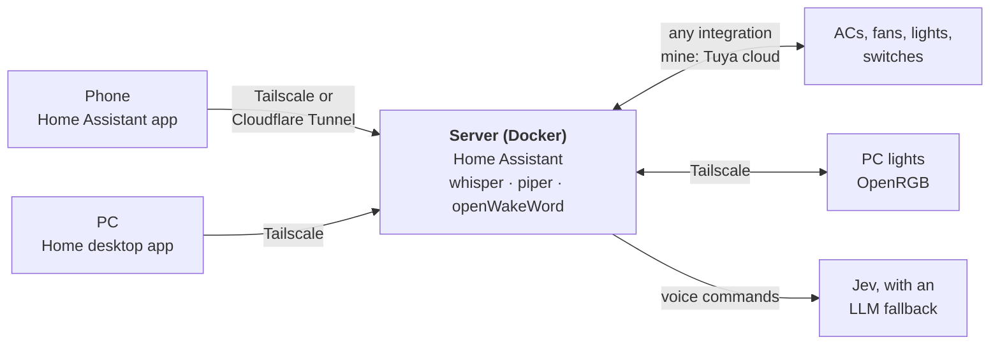

# personal-iot

My home automation, built around [Home Assistant](https://www.home-assistant.io) in Docker: one
server with local voice commands and a native desktop app. It works with whatever Home Assistant
supports. My own devices are Tuya (Smart Life) ones in two houses, so the setup script has extra
help for those.

- **Any Home Assistant device.** Voice controls anything Home Assistant does, and the desktop
  app shows its air conditioners, thermostats, fans, lights and switches on their own.
- **Local voice.** Speech-to-text, text-to-speech and the "okay nabu" wake word run on the server.
- **Home, a desktop app.** Native Rust, no browser: device buttons, a talk shortcut, a tray icon.
- **Private by default.** Reachable over Tailscale; a Cloudflare Tunnel is optional.
- **For Tuya devices:** two houses on one server with no hub, through Tuya's cloud. IR air
  conditioners get temperature, mode and fan speed, and an IR fan with learned remote buttons
  gets speeds 1–4.



## Quick start

You need a Linux server with Docker and [Tailscale](https://tailscale.com).

**1. The server.** One script does the rest, asking for what it needs as it goes:

```sh
git clone https://github.com/InterStella0/personal-iot.git ~/personal-iot
~/personal-iot/server/setup.sh
```

It creates your account with two-factor login, starts the speech services and connects them to
Home Assistant, and builds the voice assistant. Keys for Jev and DeepSeek are optional; rerun the script whenever
you have them. Add your devices' integrations in the web UI, under Settings → Devices &
services. If you use Tuya, the script waits while you do its QR login there, then adds IR air
conditioner support; type `skip` if you don't.

**2. The PC.** Build and install the desktop app, then sign in with the same account:

```sh
cd ~/personal-iot/desktop && ./install.sh
```

**3. The phone.** Install the Home Assistant app and connect to `http://<server>:8123` over
Tailscale, or set up a [Cloudflare Tunnel](docs/details.md#remote-access) to skip Tailscale.

## What's where

```
server/
├── setup.sh              sets everything up; safe to rerun
├── setup/                the part of setup that talks to Home Assistant's API
├── compose.yaml          Home Assistant, plus whisper, piper and openWakeWord
├── patches/              fixes for third-party integrations
└── ha-config/            Home Assistant's config (packages/ holds the tracked YAML)
desktop/                  Home, the desktop app (Rust)
docs/details.md           how each piece works, and what to check when something breaks
tests/jev/                voice-routing tests
```

## Roadmap

- Test Jev on 20–30 real voice commands, and switch the AC automation from dry run to live.
- The Model Context Protocol Server integration, for Claude Desktop and Claude Code.
- The second house's fan, Google Home, and Matter/Zigbee devices.

## License

[MIT](LICENSE). The patch in `server/patches/` changes
[typesafe-assist](https://github.com/JanOstrowka/typesafe-assist), which keeps its own terms. The
desktop app bundles the [Inter](https://rsms.me/inter/) font (SIL Open Font License) and
[Lucide](https://lucide.dev) icons (ISC); their licences are in `desktop/assets/`.
