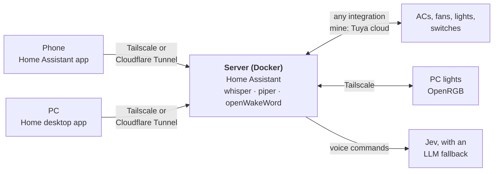

# personal-iot

My home automation, built around [Home Assistant](https://www.home-assistant.io) in Docker: one
server with local voice commands and a native desktop app. It works with whatever Home Assistant
supports. My own devices are Tuya (Smart Life) ones in two houses, so the setup script has extra
help for those.

- **Any Home Assistant device.** Voice controls anything Home Assistant does, and the desktop
  app shows its air conditioners, thermostats, fans, lights and switches on their own.
- **Jev for commands.** [TypeSafe's Jev](https://docs.typesafe.ai/introduction) turns each
  command into typed answers (which action, which device) and acts only when it's confident.
  Anything else goes to an LLM. See [Jev](#jev).
- **Local voice.** Speech-to-text, text-to-speech and the "okay nabu" wake word run on the server.
- **Home, a desktop app.** Native Rust, no browser, about 30 MB of memory: device buttons, a talk
  shortcut, a tray icon. See [the desktop app](#home-the-desktop-app).
- **Private by default.** Reachable over Tailscale; a Cloudflare Tunnel is optional.
- **For Tuya devices:** two houses on one server with no hub, through Tuya's cloud. IR air
  conditioners get temperature, mode and fan speed, and an IR fan with learned remote buttons
  gets speeds 1–4.



## Quick start

You need a Linux server with Docker and [Tailscale](https://tailscale.com).

**1. The server.** One script does the rest, asking for what it needs as it goes:

```sh
git clone https://github.com/InterStella0/personal-iot.git ~/personal-iot
~/personal-iot/server/setup.sh
```

It creates your account with two-factor login, starts the speech services and connects them to
Home Assistant, and builds the voice assistant. Keys for Jev and DeepSeek are optional; rerun the script whenever
you have them. Add your devices' integrations in the web UI, under Settings → Devices &
services. If you use Tuya, the script waits while you do its QR login there, then adds IR air
conditioner support; type `skip` if you don't.

**2. The PC.** Build and install the desktop app, then sign in with the same account:

```sh
cd ~/personal-iot/desktop && ./install.sh
```

**3. The phone.** Install the Home Assistant app and connect to `http://<server>:8123` over
Tailscale, or set up a [Cloudflare Tunnel](docs/details.md#remote-access) to skip Tailscale.

## Home, the desktop app

A native Linux app for Home Assistant, written in Rust with [iced](https://iced.rs). There's no
browser or webview inside, and it draws on the CPU: a GPU renderer would load the GPU drivers
into the app, about 95 MB, just to draw buttons. It uses about 30 MB of its own memory (45 MB
counting shared libraries), and talks only to Home Assistant's own APIs.

- **Devices, live.** Every climate, fan, light and switch in Home Assistant, from any
  integration, grouped by area with room filters, and updated the moment they change.
  Air conditioners get the target temperature, mode and fan speed. Fans get off and each speed,
  and lights and switches get on/off. An RGB light's tile glows in its current colour, and
  offline devices are greyed out.
- **Voice anywhere.** Press the mic button, or the global shortcut (Ctrl+Alt+H, set through the
  desktop portal) even while the window is hidden, and talk. The app streams the mic to Home
  Assistant's voice pipeline, shows what it heard and the reply, and plays the spoken answer.
  You can also type commands. "Always listen" streams to the server's wake word engine instead,
  for "okay nabu". Commands go to whichever Home Assistant assistant you pick, so they get the
  same Jev routing as the phone.
- **In the tray.** Talk, open, and a quick toggle per device, from the tray icon. Closing the
  window hides it there, it starts in the tray at login, and a notification shows the reply
  when the window is hidden.
- **Your login.** It signs in through Home Assistant's own login, with two-factor codes, and
  keeps the login in KWallet (or any Secret Service).

It needs libpulse (PipeWire's pulse server works) and is tested on KDE Plasma 6 (Wayland). Over
the internet, for example through a Cloudflare Tunnel, sign in with an `https://` address:
`http://` is only safe over Tailscale or your LAN.

## Jev

[Jev](https://docs.typesafe.ai/introduction) is TypeSafe's "System One" model. Instead of
writing text, it answers typed questions about a state: a choice from a list, or the probability
that something is true. This repo uses it in two places.

**Voice and typed commands.** [typesafe-assist](https://github.com/JanOstrowka/typesafe-assist)
makes Jev Home Assistant's conversation agent, and `setup.sh` installs it at a pinned commit and
puts it in the voice assistant.
- Each command is one request with many questions asked at once: which action (turn on, set the
  temperature, set the fan speed…), and which area, kind of device and device. Code then keeps
  the answers that matter.
- Jev acts only when the action's answer is at least 0.7 confident and the device's at least 0.6
  (raised from 0.5 and 0.4). When two devices are about as likely, it asks which one you meant.
- Everything else goes to the fallback LLM, DeepSeek through Home Assistant's llama.cpp
  integration: questions, chat, commands for several devices at once, and anything below the
  cutoffs.
- The model is pinned to `jev-1.13.0`, because the cutoffs are tuned per version.
- Scenes are hidden from voice, so "turn off the fan" can't match a scene instead of the fan.
- `server/patches/` fixes typesafe-assist v0.2.1 for Home Assistant 2026.10. Without it, every
  command Jev carried out crashed after running.

**Air conditioner decisions** (`server/ha-config/packages/jev_ac.yaml`, off by default).
- Every 10 minutes it sends Jev the room's temperature and humidity, the outdoor temperature,
  how many people are home, and the AC's state. It asks two questions: should the AC run (a
  probability), and in which mode (cool, dry, fan only or auto).
- It acts only above 0.75 or below 0.25, and changes the AC at most once every 30 minutes.
- It starts in dry run, which only writes its decisions to the logbook. It isn't live yet, and
  its sensors are placeholders to replace with yours.

**Tests** (`tests/jev/`) call the TypeSafe API directly with
[typesafe-sdk](https://pypi.org/project/typesafe-sdk/), against a sample house with an AC, a
fan, a light switch, a light with three brightness levels and a door sensor.
- `jev_voice_test.py`: 30 commands and questions in English, Malay and the mix of both, each run
  twice. It measures accuracy, confidence and latency.
- `jev_garbled_test.py`:
  - 14 misheard transcripts, like "too tub keep ass" for *tutup kipas* (turn off the fan);
  - 17 that must never change a device: nonsense, Whisper's "Thank you for watching."
    hallucination, TV in the background, negations like *jangan tutup kipas* (don't turn off
    the fan), devices that don't exist, and an AC set to 99°.
- `jev_gate_test.py`: adds a "is this a clear command?" question, saves every answer, and
  compares execution policies from the saved answers without paying for more requests.

These scripts test Jev with their own questions, not typesafe-assist's, and no results are
published yet. Run them as in [docs/details.md](docs/details.md#jev-tests).

**What to know before using it.**
- Every command sends TypeSafe the words plus the names and areas of everything exposed to
  voice, and their states too if "include state" is on (it's off here).
- Jev acts without asking when it's confident, so don't expose locks, garage doors or scripts
  that matter.
- It needs a TypeSafe API key and the internet. Without a key, setup skips Jev.

## What's where

```
server/
├── setup.sh              sets everything up; safe to rerun
├── setup/                the part of setup that talks to Home Assistant's API
├── compose.yaml          Home Assistant, plus whisper, piper and openWakeWord
├── patches/              fixes for third-party integrations
└── ha-config/            Home Assistant's config (packages/ holds the tracked YAML)
desktop/                  Home, the desktop app (Rust)
docs/details.md           how each piece works, and what to check when something breaks
tests/jev/                voice-routing tests
```

## Roadmap

- Test Jev on 20–30 real voice commands, and switch the AC automation from dry run to live.
- The Model Context Protocol Server integration, for Claude Desktop and Claude Code.
- The second house's fan, Google Home, and Matter/Zigbee devices.

## License

[MIT](LICENSE). The patch in `server/patches/` changes
[typesafe-assist](https://github.com/JanOstrowka/typesafe-assist), which keeps its own terms. The
desktop app bundles the [Inter](https://rsms.me/inter/) font (SIL Open Font License) and
[Lucide](https://lucide.dev) icons (ISC); their licences are in `desktop/assets/`.
